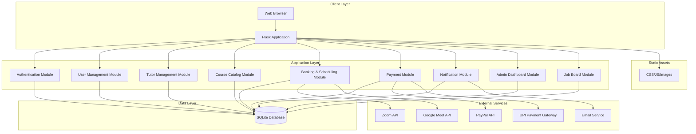
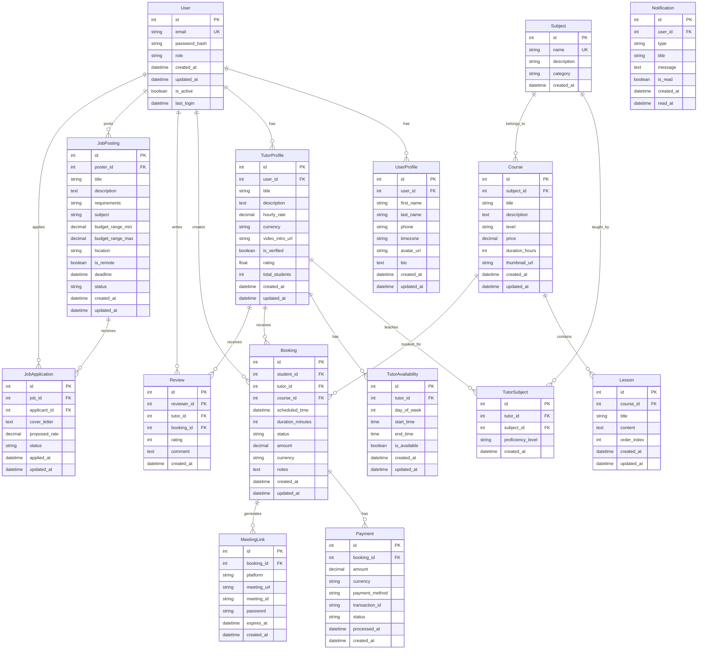

# Preply.com Clone - System Architecture Plan

## 1. High-Level System Architecture

### System Overview

The Preply.com clone will be built as a web application using Flask with a traditional server-side rendering approach. The system will follow a Model-View-Controller (MVC) pattern with clear separation of concerns.

### Architecture Diagram



### Component Descriptions

1. **Client Layer**: Web browsers that access the application through standard HTTP/HTTPS protocols.

2. **Application Layer**: Flask-based backend with modular components:
   - **Authentication Module**: Handles user login, registration, and session management
   - **User Management Module**: Manages user profiles and role-based access control
   - **Tutor Management Module**: Handles tutor profiles, expertise, pricing, and availability
   - **Course Catalog Module**: Manages subjects, courses, and search functionality
   - **Booking & Scheduling Module**: Handles lesson scheduling, calendar management, and meeting links
   - **Payment Module**: Integrates with PayPal and UPI for payment processing
   - **Notification Module**: Manages email notifications and system alerts
   - **Admin Dashboard Module**: Provides administrative interface for platform management
   - **Job Board Module**: Manages tutoring opportunity postings

3. **Data Layer**: SQLite database for development (with migration path to PostgreSQL)

4. **External Services**: Third-party integrations for payments, video conferencing, and notifications

5. **Static Assets**: CSS, JavaScript, and image files served by Flask

## 2. Database Schema Design

### Entity Relationship Diagram



### Database Table Descriptions

1. **User**: Core user authentication and role information
2. **UserProfile**: Extended user profile information common to all users
3. **TutorProfile**: Specific information for tutors
4. **Subject**: Available subjects/courses on the platform
5. **TutorSubject**: Many-to-many relationship between tutors and subjects
6. **TutorAvailability**: Tutor's available time slots
7. **Course**: Structured courses offered
8. **Lesson**: Individual lessons within a course
9. **Booking**: Scheduled lessons between students and tutors
10. **MeetingLink**: Video conferencing details for bookings
11. **Payment**: Payment records for bookings
12. **Review**: Ratings and reviews for tutors
13. **JobPosting**: Tutoring job opportunities
14. **JobApplication**: Applications for job postings
15. **Notification**: System notifications for users

## 3. API Endpoint Structure

Since we're using server-side rendering with Flask, the API endpoints will primarily serve HTML templates with some JSON endpoints for AJAX operations.

### Authentication Endpoints
```
GET  /auth/login          - Login page
POST /auth/login          - Process login
GET  /auth/register       - Registration page
POST /auth/register       - Process registration
GET  /auth/logout         - Logout user
GET  /auth/forgot-password - Forgot password form
POST /auth/forgot-password - Send password reset email
GET  /auth/reset-password/<token> - Reset password form
POST /auth/reset-password - Process password reset
```

### User Management Endpoints
```
GET  /profile             - View user profile
GET  /profile/edit        - Edit profile form
POST /profile/edit        - Update profile
GET  /profile/password    - Change password form
POST /profile/password    - Update password
```

### Tutor Management Endpoints
```
GET  /tutor/dashboard     - Tutor dashboard
GET  /tutor/profile       - Tutor profile view
GET  /tutor/profile/edit  - Edit tutor profile
POST /tutor/profile/edit  - Update tutor profile
GET  /tutor/availability  - Manage availability
POST /tutor/availability  - Update availability
GET  /tutor/schedule      - View schedule
GET  /tutor/earnings      - View earnings
```

### Course Catalog Endpoints
```
GET  /                    - Home page
GET  /courses             - Browse courses
GET  /courses/<id>        - Course details
GET  /subjects            - Browse subjects
GET  /subjects/<id>       - Subject details
GET  /search              - Search results
POST /search              - Process search
```

### Booking & Scheduling Endpoints
```
GET  /booking/<tutor_id>  - Book a tutor
POST /booking/create      - Create booking
GET  /booking/<id>        - Booking details
GET  /booking/cancel/<id> - Cancel booking
POST /booking/cancel/<id> - Process cancellation
GET  /booking/reschedule/<id> - Reschedule booking
POST /booking/reschedule/<id> - Process rescheduling
GET  /student/bookings    - Student's bookings
GET  /tutor/bookings     - Tutor's bookings
```

### Payment Endpoints
```
GET  /payment/<booking_id> - Payment page
POST /payment/process     - Process payment
GET  /payment/success     - Payment success
GET  /payment/cancel      - Payment cancellation
GET  /payment/history     - Payment history
```

### Meeting Integration Endpoints
```
GET  /meeting/create/<booking_id> - Create meeting
POST /meeting/create      - Process meeting creation
GET  /meeting/join/<id>   - Join meeting
```

### Admin Dashboard Endpoints
```
GET  /admin               - Admin dashboard
GET  /admin/users         - User management
GET  /admin/tutors        - Tutor verification
GET  /admin/courses       - Course management
GET  /admin/bookings      - Booking oversight
GET  /admin/payments      - Payment management
GET  /admin/reports       - Reports and analytics
```

### Job Board Endpoints
```
GET  /jobs                - Browse job postings
GET  /jobs/<id>           - Job details
GET  /jobs/create         - Create job posting
POST /jobs/create         - Process job creation
GET  /jobs/edit/<id>      - Edit job posting
POST /jobs/edit/<id>      - Update job posting
GET  /jobs/apply/<id>     - Apply for job
POST /jobs/apply/<id>     - Submit application
GET  /jobs/my-applications - View applications
GET  /jobs/my-postings    - View own postings
```

### AJAX Endpoints (JSON responses)
```
GET  /api/tutors/available - Get available tutors
GET  /api/timeslots/<tutor_id> - Get available time slots
POST /api/notification/read - Mark notification as read
GET  /api/search/suggest   - Search suggestions
POST /api/review/create    - Create review
```

## 4. Technology Stack Recommendations

### Backend Framework
- **Flask**: Lightweight and flexible web framework
- **Flask-SQLAlchemy**: ORM for database operations
- **Flask-Login**: User session management
- **Flask-WTF**: Form handling and CSRF protection
- **Flask-Migrate**: Database migration management
- **Flask-Mail**: Email sending functionality
- **Flask-Caching**: Response caching for performance

### Database
- **SQLite**: For development (as requested)
- **PostgreSQL**: Recommended for production (migration path)

### Authentication & Security
- **Werkzeug**: Password hashing and security utilities
- **Flask-JWT-Extended**: For API token authentication if needed
- **Flask-Talisman**: Security headers and HTTPS enforcement

### Frontend
- **Jinja2**: Template engine (built into Flask)
- **Bootstrap 5**: CSS framework for responsive design
- **jQuery**: JavaScript library for DOM manipulation and AJAX
- **Flatpickr**: Date/time picker for scheduling
- **Chart.js**: For dashboard analytics

### Payment Integration
- **PayPal SDK**: For PayPal payment processing
- **Razorpay**: Popular UPI payment gateway for India

### Video Conferencing Integration
- **Zoom SDK**: For Zoom meeting integration
- **Google Meet API**: For Google Meet integration

### Email Service
- **SendGrid**: Reliable email delivery service
- **SMTP**: As fallback option

### Development Tools
- **Flask-DebugToolbar**: Debugging toolbar for development
- **Flask-Testing**: Unit testing framework
- **pytest**: Testing framework
- **Black**: Code formatting
- **Flake8**: Code linting

### Deployment
- **Gunicorn**: WSGI server
- **Nginx**: Reverse proxy and static file serving
- **Docker**: Containerization for deployment
- **Heroku/DigitalOcean**: Hosting options

## 5. Security Considerations

### Authentication & Authorization
1. **Password Security**:
   - Use strong password hashing (bcrypt)
   - Implement password complexity requirements
   - Secure password reset functionality

2. **Session Management**:
   - Secure session cookies (HTTPOnly, Secure, SameSite)
   - Implement session timeout
   - Proper session invalidation on logout

3. **Role-Based Access Control**:
   - Implement proper role checking for all protected routes
   - Use decorators for role verification
   - Prevent privilege escalation attacks

### Data Protection
1. **Input Validation**:
   - Validate all user inputs on both client and server side
   - Use parameterized queries to prevent SQL injection
   - Sanitize user-generated content

2. **CSRF Protection**:
   - Implement CSRF tokens for all state-changing forms
   - Use Flask-WTF's built-in CSRF protection

3. **XSS Prevention**:
   - Escape user-generated content in templates
   - Implement Content Security Policy headers
   - Use HTTP headers for security

### API Security
1. **Rate Limiting**:
   - Implement rate limiting for API endpoints
   - Prevent brute force attacks on authentication

2. **HTTPS Enforcement**:
   - Redirect all HTTP traffic to HTTPS
   - Use HSTS headers

### Payment Security
1. **PCI Compliance**:
   - Never store credit card information
   - Use reputable payment processors
   - Implement proper payment verification

2. **Transaction Security**:
   - Validate payment amounts before processing
   - Implement proper refund mechanisms
   - Log all payment transactions

### Privacy Protection
1. **Data Minimization**:
   - Collect only necessary user information
   - Implement data retention policies

2. **Privacy Controls**:
   - Provide user privacy settings
   - Implement data export functionality
   - Allow account deletion with data removal

## 6. Project Structure Recommendation

```
tutorPro/
├── app/
│   ├── __init__.py              # Flask app factory
│   ├── models/                  # Database models
│   │   ├── __init__.py
│   │   ├── user.py
│   │   ├── tutor.py
│   │   ├── course.py
│   │   ├── booking.py
│   │   ├── payment.py
│   │   ├── job.py
│   │   └── notification.py
│   ├── auth/                    # Authentication blueprint
│   │   ├── __init__.py
│   │   ├── forms.py
│   │   └── routes.py
│   ├── main/                    # Main application blueprint
│   │   ├── __init__.py
│   │   ├── forms.py
│   │   └── routes.py
│   ├── tutor/                   # Tutor-specific blueprint
│   │   ├── __init__.py
│   │   ├── forms.py
│   │   └── routes.py
│   ├── student/                 # Student-specific blueprint
│   │   ├── __init__.py
│   │   ├── forms.py
│   │   └── routes.py
│   ├── admin/                   # Admin blueprint
│   │   ├── __init__.py
│   │   ├── forms.py
│   │   └── routes.py
│   ├── api/                     # API endpoints
│   │   ├── __init__.py
│   │   ├── auth.py
│   │   ├── tutors.py
│   │   ├── bookings.py
│   │   └── payments.py
│   ├── services/                # Business logic
│   │   ├── __init__.py
│   │   ├── auth_service.py
│   │   ├── email_service.py
│   │   ├── payment_service.py
│   │   ├── meeting_service.py
│   │   └── notification_service.py
│   ├── utils/                   # Utility functions
│   │   ├── __init__.py
│   │   ├── decorators.py
│   │   ├── helpers.py
│   │   └── validators.py
│   ├── static/                  # Static files
│   │   ├── css/
│   │   ├── js/
│   │   └── images/
│   └── templates/               # Jinja2 templates
│       ├── base.html
│       ├── auth/
│       ├── main/
│       ├── tutor/
│       ├── student/
│       ├── admin/
│       └── errors/
├── migrations/                  # Database migrations
├── tests/                       # Test files
│   ├── __init__.py
│   ├── conftest.py
│   ├── test_auth.py
│   ├── test_models.py
│   ├── test_routes.py
│   └── test_services.py
├── config/                      # Configuration files
│   ├── __init__.py
│   ├── development.py
│   ├── production.py
│   └── testing.py
├── logs/                        # Application logs
├── requirements.txt             # Python dependencies
├── requirements-dev.txt         # Development dependencies
├── .env.example                 # Environment variables example
├── .gitignore                   # Git ignore file
├── README.md                    # Project documentation
├── run.py                       # Application runner
└── wsgi.py                      # WSGI entry point
```

### Key Components

1. **Blueprints**: Modular application structure using Flask blueprints for different functional areas
2. **Models**: SQLAlchemy models representing database tables
3. **Services**: Business logic separated from routes for better maintainability
4. **Forms**: WTForms classes for form handling and validation
5. **Templates**: Jinja2 templates organized by functional area
6. **Configuration**: Environment-specific configuration files
7. **Tests**: Comprehensive test suite for all components

This structure provides:
- Clear separation of concerns
- Scalability for future enhancements
- Maintainability through organized code
- Testability with isolated components
- Environment-specific configurations

## Conclusion

This architecture plan provides a comprehensive foundation for building a Preply.com clone using Flask. The design emphasizes:

1. **Modularity**: Clear separation of components for maintainability
2. **Scalability**: Architecture that can grow with the user base
3. **Security**: Multiple layers of security protection
4. **User Experience**: Features that match or exceed Preply's offerings
5. **Developer Experience**: Well-structured codebase for efficient development

The next phase would involve implementing this architecture following the recommended project structure, starting with core models and authentication, then progressively adding features.